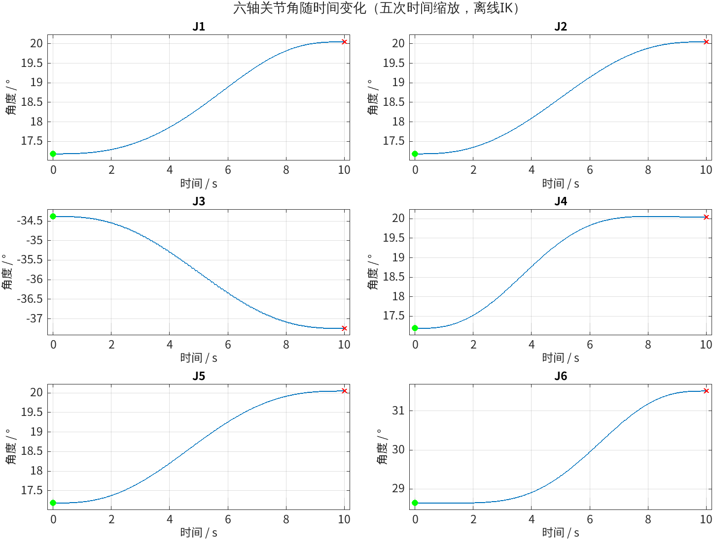
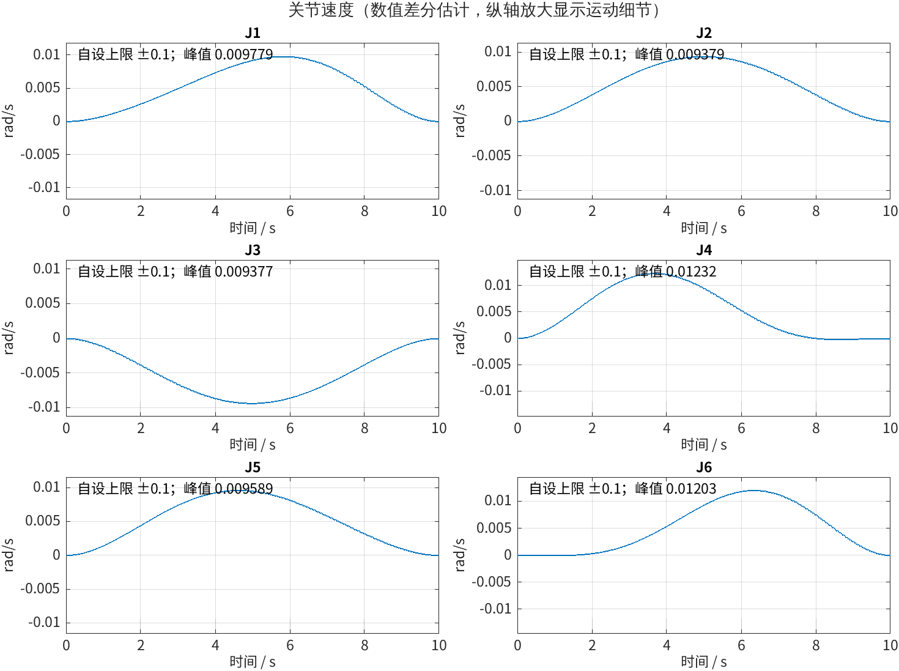
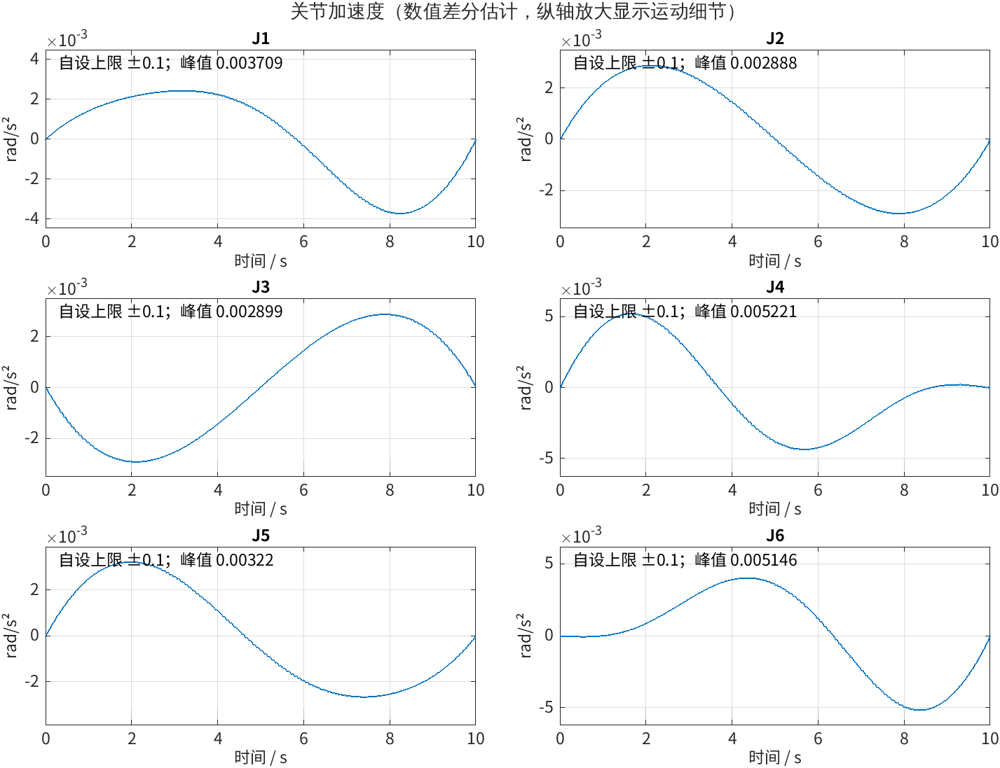
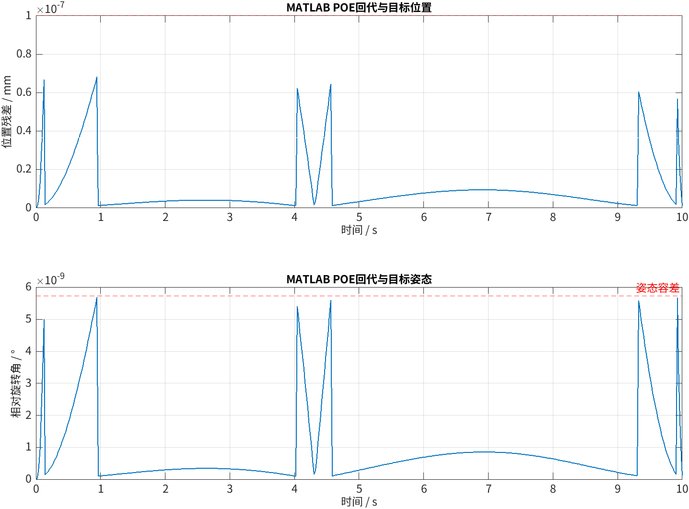
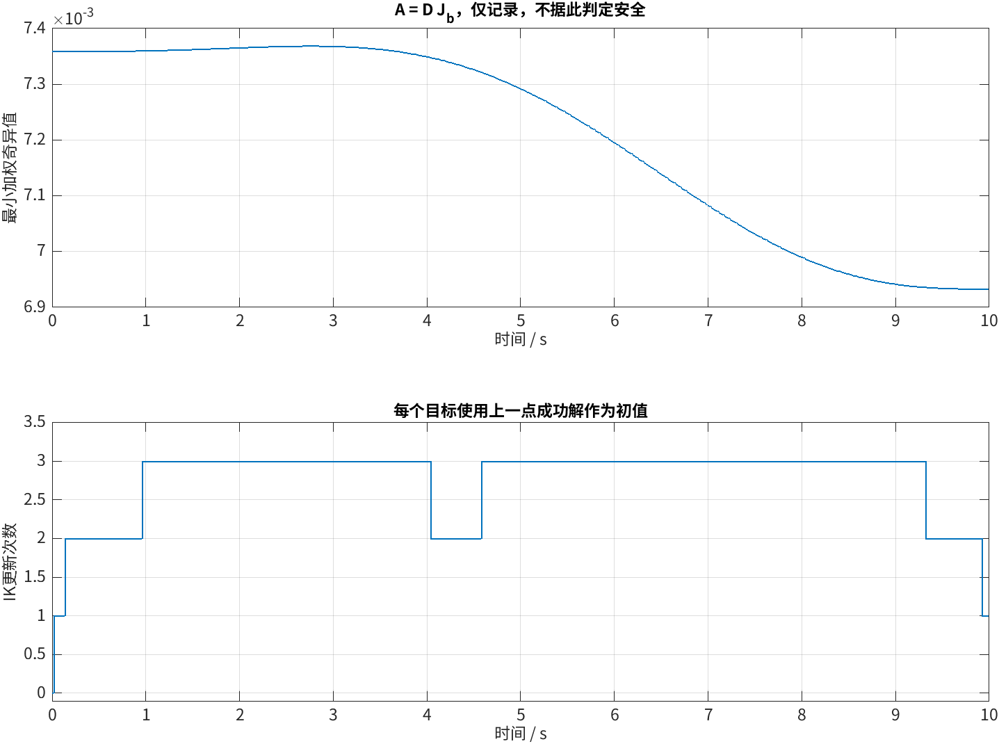
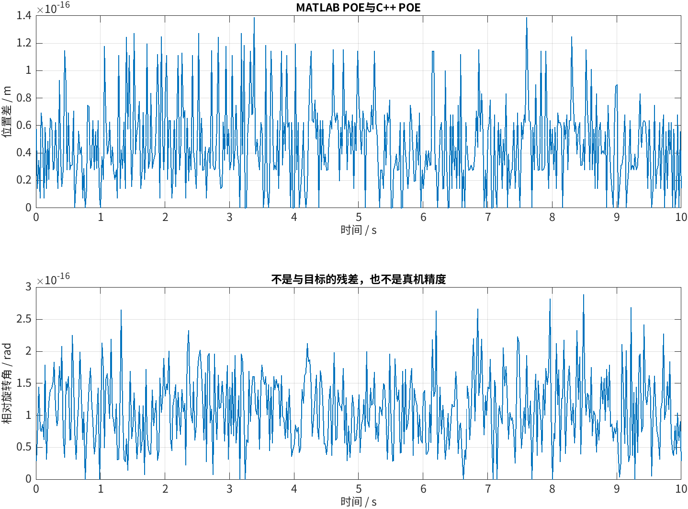

# PiPER 时间参数化与平滑启停离线IK验证

## 1. 实验目的

在原SE(3)几何路径上增加执行时间与五次时间缩放，生成关节角随时间的变化，
估计速度、加速度并检查自设离线约束；由MATLAB独立复核C++结果。

## 2. 数据与条件

- 更新日期：2026-10-19；沿用10-18实验目录。本次不连接CAN或控制真机。
- 起点角：`[0.30,0.30,-0.60,0.30,0.30,0.50]` rad。
- 终点参考角：`[0.35,0.35,-0.65,0.35,0.35,0.55]` rad；经FK生成目标终点。
- 路径保持 `T(s)=T0*exp(s*log(T0^-1*T1))`；每点以上一个成功解作为DLS初值。
- 总时长10 s，501个等时间采样点，间隔0.02 s；这不是已执行的50 Hz控制循环。
- 时间缩放：`u=t/T`，`s=10u^3-15u^4+6u^5`；解析ds/dt与d²s/dt²在起终点为0。
- 为减小差分放大的IK误差，位置与姿态容差由旧版1e-6收紧为1e-10 m和1e-10 rad。
- 固定阻尼0.001、旋转权重0.2；IK内部关节更新上限0.1 rad，相邻输出解上限0.05 rad；最多1000次迭代。
- 自设离线速度上限0.1 rad/s、加速度上限0.1 rad/s²，各轴相同。不是厂家限值，也不是已核实真机参数。
- 输入：`data_csv/trajectory.csv`，501行、94列。保留旧75列，追加时间、路径导数、dq、ddq和4个配置字段。
- Git提交号：待归档时补充。

## 3. 处理方法与运行

### C++生成CSV

```bash
cmake --build build/debug --target ik_trajectory_validation
./build/debug/ik_trajectory_validation /tmp/ik_timed_recheck.csv 10
```

从仓库根目录运行；输出父目录须存在且目标文件不得已存在。不传参数只打印。
全部IK、FK回代、限位、相邻增量和数值导数检查通过后才写CSV。
时长10为秒，可以调整；501点不变，因此调整时长同时改变采样间隔。
过短时长超限会非零退出，不生成CSV。

### 导数与数值处理

内点采用中心差分：速度为`(q[i+1]-q[i-1])/(2dt)`，加速度为
`(q[i+1]-2q[i]+q[i-1])/dt²`。首尾分别用四点单边公式估计，不人为填0。
解析平滑的是路径进度；IK解和差分存在数值误差，因此端点估计值接近0而非强制为0。

测试发现旧C++小角度exp/log会截断微小旋转，导致收紧容差后的IK停滞；
本次改用小角度级数与atan2求角，并加入小角度往返回归测试，没有修改模型参数。

### MATLAB分析

运行 `MATLAB/experiments/project1/2026-10-18_ik_trajectory/matlab_plot.m`：

1. 核对CSV列、有限值、时间、五次进度、配置与关节限位。
2. 根据q独立复算MATLAB POE、目标残差、增量和加权雅可比最小奇异值。
3. 根据q与dt复算速度、加速度，核对CSV导数与自设上限。
4. 精简版输出两份统计CSV与6张核心PNG，原CSV不由MATLAB修改。相邻增量仍检查，不再单独绘图；大幅预览和重复MAT结果已归档。

## 4. 实验结果

| 指标 | 结果 | 条件 |
| --- | ---: | --- |
| 采样点 | 501/501 | 全部通过 |
| 总时长 / 时间间隔 | 10 s / 0.02 s | 等时间采样 |
| 最大位置残差 | 6.806294e-11 m | ≤1e-10 m |
| 最大姿态残差 | 9.931398e-11 rad | ≤1e-10 rad |
| 最大相邻关节增量 | 2.463742e-4 rad | ≤0.05 rad |
| 六轴最大速度绝对值 | 0.01231852 rad/s | ≤0.1 rad/s，自设离线约束 |
| 六轴最大加速度绝对值 | 0.005221314 rad/s² | ≤0.1 rad/s²，自设离线约束 |
| 首尾最大速度估计绝对值 | 1.5651e-8 rad/s | 单边差分，非强制置零 |
| 首尾最大加速度估计绝对值 | 2.8048e-6 rad/s² | 单边差分，非强制置零 |
| 最小加权奇异值 | 6.932832e-3 | 仅记录，不是安全阈值 |
| 总IK更新次数 / 单点最大 | 1380 / 3 | 不是运行时间 |
| MATLAB/C++最大位置差 | 1.3878e-16 m | ≤1e-9 m |
| MATLAB/C++最大旋转差 | 2.8861e-16 rad | ≤1e-8 rad |

全部采样点通过限位、回代、相邻增量和自设导数检查。
Debug、Release各20项CTest通过；MATLAB分析与损坏CSV拒绝测试通过。
旧版几何CSV、5张结果图、统计和报告已备份到项目外：
`/home/nbw/piper_experiment_backups/ik_geometric_before_timing_2026-10-19.rFhBo8/`。
当前目录仅保留新版CSV与重新生成的分析图表，不混用旧数据。

## 5. MATLAB结果图














读图：先看q-t、dq-t、ddq-t及首尾变化，再看增量、残差和求解代价。
速度与加速度图纵轴按数据放大，各子图标注离线上限和峰值；上限超出显示范围时红线不可见。
数值导数可能出现因差分与IK容差产生的微小起伏，不能视为已观测到真机抖动。

## 6. 结论与局限

本路径在10秒五次时间缩放下通过501点离线验证，速度和加速度差分估计满足本次自设上限。

- 检查只覆盖采样点，不能保证点间极值；未做碰撞、力矩或硬件执行验证。
- 差分会放大IK误差，改变采样间隔或容差后须重新检查，不是连续导数的严格界。
- 未采集CAN与外部测量，不代表实际定位精度、跟踪精度或实时性能。
- 延长时长通常可降低同路径的速度和加速度；不能以通过离线上限替代硬件参数核实。
- 该路径成功不代表任意路径、初值或时长都可行，当前CSV不可直接作为真机放行依据。

## 7. 照片与视频

离线数值实验，无真机照片或视频。

## 8. RViz模型预览

新增`tools/ros2/csv_trajectory_preview.py`：读取本实验CSV，检查角度、时间及有限值，
转为`DisplayTrajectory`并只发布到`/display_planned_path`。不重新规划或改变CSV时间，
不发布控制指令、不执行Action，也不自动做碰撞检查。
使用已有官方MoveIt离线环境，`State Display Time`设为`1x`按CSV时间播放。
完整步骤见`tools/ros2/README.md`；预览通过不能替代真机执行和安全验证。

现场发现本机RViz 14.1.23与MoveIt 2.12.4的动画时间单位不匹配，Planned Path一闪而过；
仅确认消息收发不能认定动画验收通过。新增`--state-playback`作为项目内兼容模式：
按单调时钟逐点发布DisplayRobotState到`/offline_preview/display_robot_state`，
RViz另加RobotState显示，停用MotionPlanning动画。不修改CSV或系统库，不发送控制指令。
独立时钟消息收发与约10秒持续时间可由集成测试检查；实际画面仍需人工确认。
